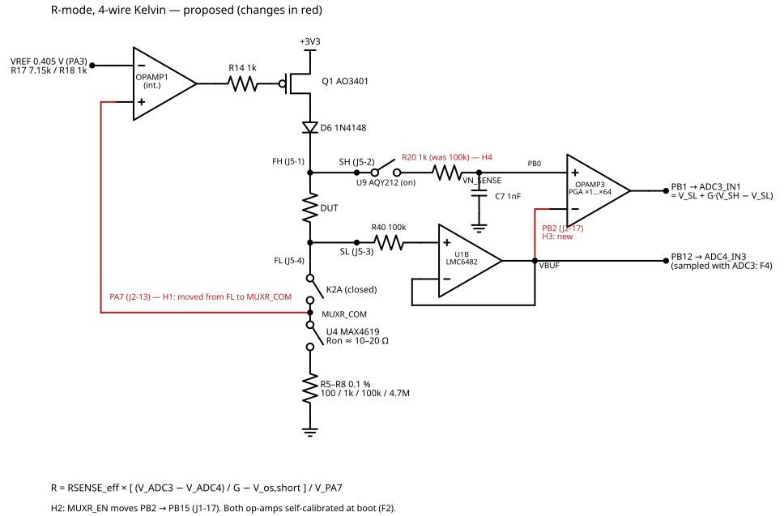
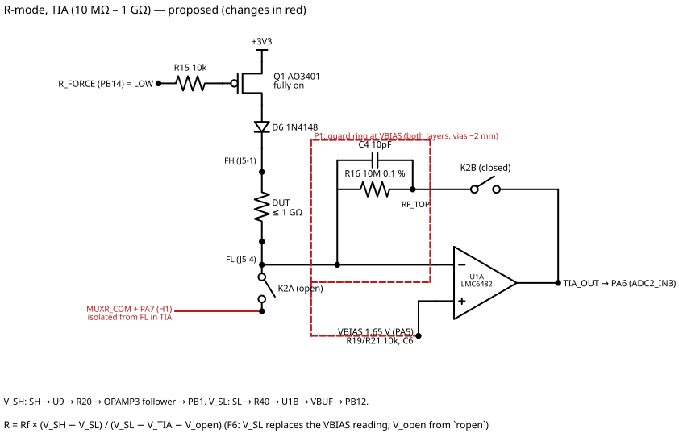
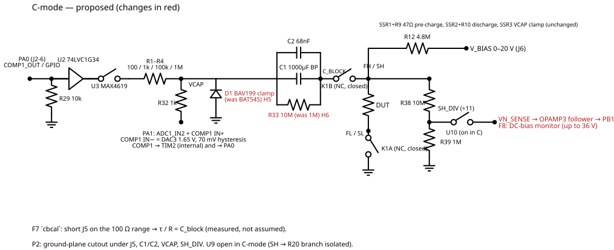

# Accuracy plan — changes to the Rev C schematic before layout

**Status:** H1–H6 and the PCB rules P1/P2/P4 are **applied** in `hardware/kicad/` (Rev C.1, 2026-11-13). Firmware items F1–F11 are **not yet implemented**.
**Applies to:** the Rev C schematic in `hardware/kicad/Project.kicad_sch` (PCB not
started). Every change below is a net move or a value swap on that schematic,
plus firmware.
**Constraint:** no new component *types*. Every part used here is already a line
in `hardware/fab/Project-bom.csv`.

The diagrams below show only the path that matters in each mode; the full
schematic is still `hardware/kicad/Project.kicad_sch`. Changes are in red. They
are generated by `docs/img/draw_accuracy_diagrams.py` (schemdraw).

**R-mode, 4-wire Kelvin**

**R-mode, TIA**

**C-mode**

---

## 1. Where accuracy is lost today

| Measurement | Main error source | Rough worst case, Rev C as drawn |
|---|---|---|
| R, Kelvin, 1–10 Ω | V_SH − V_SL is 4–40 mV. OPAMP3 offset (up to ±3 mV) plus two separate, non-simultaneous ADC readings (±1–2 LSB, 0.8 mV each) | 10 % to >50 % |
| R, Kelvin, 5–50 kΩ | Same signal problem: this band sits low on the 100 k element (ΔV 19–190 mV) | 2–15 % |
| R, Kelvin, ~1 MΩ | Pin and switch leakage on the sense node compared with an 86 nA test current | ~1 % |
| R, TIA, 100 MΩ–1 GΩ | **PA7 (OPAMP1 input) sits on the TIA summing node FL**; its pin leakage adds directly to a ~1 nA signal. Also the LMC6482 offset against a 10 mV feedback signal, and PCB leakage | 5–100 % at 1 GΩ |
| C, ≤10 pF | Stray capacitance drift (ground plane, socket) after the open tare | ~2 % |
| C, ≥10 µF | C_block (1000 µF ±20 % electrolytic) not measured | ~2 % at 100 µF |
| C, DC bias | DUT bias sags (R33 bleed, C1 leakage) and the firmware can't see it | Unknown, about 1 % per minute at 20 V |
| Everything | Ron of the MAX4619 is inside the sense current and drifts with temperature | ~0.5 % on the 100 Ω element |

A precision reference **isn't** needed. Every result is a ratio of two readings
taken against the same 3.3 V rail: the Kelvin and TIA equations, the RC time
constant, and the oscillator thresholds (DAC3 and the drive buffer both track
3.3 V). Keep VREF+ on VDDA and never enable VREFBUF.

---

## 2. Hardware changes (no new part types)

### 2.1 Net moves

| # | Change | Before | After | Why |
|---|---|---|---|---|
| H1 | **OPAMP1 sense moves from FL to MUXR_COM** | J2-13 (PA7) on `FL` | J2-13 (PA7) on `MUXR_COM` (the K2A NO side) | In TIA mode K2A opens, so **PA7's pin leakage leaves the TIA summing node**. This is the biggest error at 1 GΩ. In Kelvin mode the loop now regulates the mux common, so K2A's contact resistance also drops out of the current. |
| H2 | **MUXR_EN moves PB2 → PB15** | J2-17 = `MUXR_EN`, J1-17 NC | J1-17 (PB15) = `MUXR_EN` (R31 pull-up moves with it) | Frees PB2, OPAMP3's VINM0 pin. PB15 is unused on the WeAct module and NC in Rev C. |
| H3 | **VBUF also goes to PB2** | `VBUF` → J1-20 (PB12) only | `VBUF` → J1-20 (PB12) **and** J2-17 (PB2) | OPAMP3 can then run as a **PGA referenced to V_SL**: V_out = V_SL + G·(V_SH − V_SL). The few-mV Kelvin difference is amplified ×2…×64 **before** the ADC, so 1 Ω goes from ~5 ADC steps to ~160. |

### 2.2 Value swaps (values already on the BOM)

| # | Part | Before | After | Why |
|---|---|---|---|---|
| H4 | R20 | 100 kΩ | **1 kΩ** (R14/R18 line) | U9 now isolates the SH → R20 branch in C-mode, so R20 no longer has to survive the 20 V bias. A smaller R20 cuts the leakage error on `VN_SENSE` by 100× (1 nA × 100 k = 100 µV, against 1 µV). C7 1 nF with 1 k gives τ = 1 µs. |
| H5 | D1 (VCAP clamp) | BAT54S | **BAV199** (D2 line) | BAT54 reverse leakage (up to µA at temperature) through the 1 MΩ range resistor shifts V_cap. BAV199 is a low-leakage diode. |
| H6 | R33 (C1 bleed) | 1 MΩ | **10 MΩ** (R16/R38 line) | Cuts the DC-bias sag on the DUT tenfold. Active discharge through SSR2/SSR3 stays the safety path; at 20 V C1 holds only 0.2 J. |

**BOM delta:** BAV199 +1, 1 kΩ +1, 10 MΩ +1; BAT54S −1, 100 kΩ −1, 1 MΩ −1.
**No new grouped lines, no new orderable part types.**

### 2.3 Keep, but use differently

| Block | Rev C intent | Proposed use |
|---|---|---|
| R38/R39/C20/C21 `SH_DIV` + U10 | AC 4-terminal C sensing through OPAMP3 | **DUT DC-bias monitor.** The C7 pole (≈177 Hz at 0.91 MΩ) and OPAMP3 leakage make it a poor AC path, but it measures the real DC bias on the DUT to ~0.1 %: up to 36 V full scale at ÷11. That fixes the "bias sag nobody can see" problem. |

### 2.4 PCB rules (free, because layout hasn't started)

| # | Rule |
|---|---|
| P1 | **TIA guard ring at `VBIAS`** around FL, RF_TOP, R16/C4 and U1A pin 2. Use a ring on both layers with vias every ~2 mm. VBIAS is the TIA's own virtual-ground potential, so surface leakage from the summing node into the guard carries no current. |
| P2 | **Bottom-layer ground-plane cutout** under J5, `SH_DIV` (R38/R39/C20/C21), C1/C2 `C_BLOCK`, `VCAP` and RF_TOP. This cuts stray capacitance to pF-range C-mode readings and leakage to the TIA. |
| P3 | **High-impedance traces under 10 mm.** Put R38/R39 at J5. Put U1 and K2 within ~10 mm of J5. Run FL, SL and SH as short, separate traces that meet only at J5. |
| P4 | **Thermals:** keep K1/K2 coils and the 3V3 entry (J4) away from U4 and R5–R8. Ron and the sense resistors drift with temperature. |
| P5 | **Ground returns:** R5–R8 and U4 return to a single analog ground point near J2-1; relay coils and SSR LEDs return separately toward J4. |
| P6 | **Test pads** on VREF, VBIAS, MUXR_COM, VBUF, VN_SENSE, SH_DIV and TIA_OUT, for bench calibration. |
| P7 | No solder mask openings or silkscreen between FL/SL/RF_TOP pads. Wash off the flux. Don't conformal-coat across the high-impedance gaps. |

---

## 3. Firmware changes

| # | Change |
|---|---|
| F1 | **Pin map:** `PIN_MUXR_EN` → PB15. OPAMP1 VINP (PA7, `IO2`) is now `MUXR_COM`. PB2 = VBUF reference (OPAMP3 VINM0). PC4 = `C_MODE_SW` (active low: low in C-mode, high in R-mode). PA8 = `BIAS_MON` (analog, ADC5_IN1). Remove the PB15 `VBIAS_RETURN` drive. Relay comment: G6S-2 DC3 on 3.3 V. |
| F2 | **OPAMP self-calibration at boot** for OPAMP1 and OPAMP3, with the output on the pin first so `CALOUT` is visible. `bsp_opamp1_calibrate()` exists but is never called. |
| F3 | **OPAMP3 modes:** follower for C-mode (`SH_DIV`) and TIA (V_SH). In Kelvin, **PGA with bias on VINM0** (`OPAMP_PGA_CONNECT_INVERTINGINPUT_IO0_BIAS`), gain chosen so V_SL + G·ΔV stays below ~3.0 V. Check this mode's exact behaviour in RM0440 before relying on it. |
| F4 | **ADC3 + ADC4 in dual simultaneous mode** (OPAMP3 out on PB1/ADC3_IN1, VBUF on PB12/ADC4_IN3), 256× hardware oversampling. Both halves of the difference are then taken at the same instant, so rail noise cancels. |
| F5 | **4-wire Kelvin:** R = RSENSE_eff × [(V_ADC3 − V_ADC4)/G − V_os,short] / V_MUXR_COM, with V_MUXR_COM read on PA7 (ADC2_IN4). Gain G is calibrated per setting. |
| F6 | **TIA:** R = Rf × (V_SH − V_SL) / (V_SL − V_TIA − V_open), with V_SL from VBUF (not the VBIAS divider) and V_open from an open-circuit tare. This removes the TIA offset from the denominator. |
| F7 | **Calibration commands:** `rshort` (shorted J5, per element × gain), `ropen` (open J5, TIA), `cbcal` (shorted J5, 100 Ω C range: measures C_block directly as τ/R), `biascal` (known V_BIAS → `SH_DIV` ratio). Store them in the existing flash record. |
| F8 | **C-mode bias monitor:** read `SH_DIV` before and after each capture and report the actual bias in `@@EVT`. Re-pre-charge when it has sagged more than 1 %. |
| F9 | **Settling:** relay settle 10 → 50 ms (contact bounce, LDO recovery, thermal EMF). Discard the first conversion after any mux or gain change. |
| F10 | **Temperature:** log the internal temperature sensor with each result, and warn when it's more than 5 °C from the calibration temperature. |
| F11 | **Ladder:** R-mode autorange picks element **and** PGA gain. The 5–50 kΩ gap on the 100 k element is covered by G = 8…16. |

---

## 4. Expected result (estimates; confirm on the bench)

| Measurement | Rev C as drawn | With this plan | What dominates afterwards |
|---|---|---|---|
| 1 Ω | >50 % | **1–2 %** | Offset drift after `rshort`, Ron drift |
| 100 Ω | ~1 % | **0.1–0.3 %** | RSENSE_eff calibration, Ron tempco |
| 10 kΩ | 2–15 % | **0.1–0.3 %** | PGA gain calibration |
| 1 MΩ | ~1 % | **0.3–0.5 %** | Sense-node leakage |
| 100 MΩ | ~2 % | **0.3–0.5 %** | Rf (0.1 %), open tare |
| 1 GΩ | 5–100 % | **1–3 %** | PCB and humidity leakage, guard quality |
| 10 pF | ~2 % | **0.5–1 %** | Stray drift after the open tare |
| 100 µF | ~2 % | **~0.1 %** | `cbcal` repeatability |
| DC bias at DUT | Unknown | **~0.1 %**, monitored | `biascal` |

---

## 5. Calibration procedure (after assembly)

1. Warm up for 10 minutes with both relays toggled a few times.
2. `rshort`: short J5 with four-wire links. Run every element and gain.
3. `rcal <element> <ohm>` on each element with a 0.1 % reference at J5.
4. `ropen`: J5 open, TIA mode. Then `rcal tia <Rf> …` with a ≥100 MΩ reference.
5. `cbcal`: J5 shorted, C-mode. Record C_block.
6. `zero` (open J5), then `cal1`/`cal2` and `adccal1`/`adccal2` with C0G/film references.
7. `biascal`: apply a known V_BIAS (measure it with a DMM) and record the `SH_DIV` ratio.
8. Note the temperature. Repeat steps 2 and 5 if the board's environment changes.

---

## 6. Bench checks specific to this plan

| Check | Expected | If it fails |
|---|---|---|
| OPAMP3 PGA with bias, G = 16, short at J5 | Output ≈ V_SL (within the amplified offset) | PGA bias mode not as assumed: fall back to follower plus oversampling |
| OPAMP3 gain per setting, against a 10 Ω reference | Within ~1 % of nominal, stable | Use measured gains only |
| PA7 on MUXR_COM, TIA at 1 GΩ | Open-circuit V_TIA drift < 1 mV over 10 min | Look for leakage on FL; check the guard |
| U9 off-leakage at 20 V bias, C-mode | `SH_DIV` reading matches a DMM within 0.5 % | U9 leakage into VN_SENSE. Leave U9's VN_IN side clamped, or bias-monitor at a lower V_BIAS. |
| Ron on the 100 Ω element, 25 → 40 °C | RSENSE_eff changes < 0.5 % | Calibrate at operating temperature |

---

## 7. Options that need a new part (not taken)

| Option | Gain | Why not now |
|---|---|---|
| External fA buffer for V_SH/`SH_DIV` (second LMC6482, or TI's suggested TLV9152; check its bias current) | Removes internal-op-amp leakage and offset entirely | The second LMC6482 is unavailable; H3/H4 + F2/F3 get most of the benefit |
| Precision reference | None for this design | Everything is ratiometric |
| Lower R_sense element for more current | More signal at 1 Ω | MAX4619 Ron (~10–20 Ω at 3.3 V) would dominate a 10 Ω element; the PGA (H3) does the job instead |
| Active C-mode guard driver | Lower pF stray | Needs an op-amp and a free pin |

---

## 8. Open questions for the schematic owner

1. Is `MUXR_COM` free to take the PA7 connection (H1)? Does anything else expect PA7 on FL?
2. Is anything planned for PB15 (J1-17)? This plan uses it for MUXR_EN (H2).
3. Was U10/`SH_DIV` meant for AC 4-terminal C? This plan repurposes it as the DC-bias monitor (2.3).
